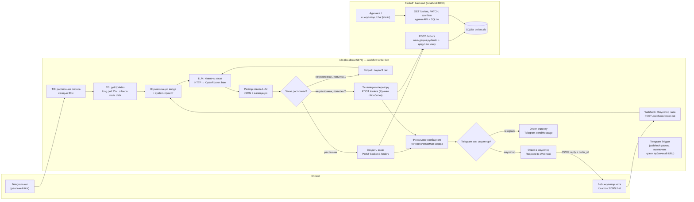

# Архитектура

## Общая схема

## Компоненты

| Компонент | Технологии | Роль |
|-----------|------------|------|
| n8n workflow | n8n, HTTP Request, Code, Switch, Wait, Webhook, Telegram | оркестрация всего флоу; LLM-вызов делает сам n8n |
| LLM | OpenRouter, бесплатные модели (`:free`, по умолчанию `nvidia/nemotron-3-super-120b-a12b:free`) | свободный текст → строгий JSON (услуга, поля, срочность, имя, контакт, valid) |
| Backend | Python, FastAPI, pydantic, SQLAlchemy, SQLite | приём структурированных заказов, дедуп, статусы, подтверждения, админка |
| Эмулятор чата | static HTML/JS (отдаёт backend) | демо без реального Telegram-токена: шлёт webhook в n8n, рисует ответ бота |
| Инфраструктура | docker compose, healthchecks | `docker compose up` поднимает всё |

## Поток данных (успешный путь)

1. Клиент пишет текстом в Telegram **или** в эмуляторе (`POST /webhook/order-bot`, body `{text, name, source}`).
2. Приём из Telegram — polling-цепочка: «TG: расписание опроса» (каждые 30 с) → «TG: смещение (offset)» → «TG: getUpdates» (long poll 25 с, токен из `TELEGRAM_BOT_TOKEN` в окружении n8n) → «TG: новые сообщения» (offset в static data воркфлоу, первый опрос отмечает накопившееся прочитанным). Встроенный «Telegram Trigger» — webhook-режим, для него нужен публичный URL, поэтому нода выключена.
3. «Нормализация ввода» приводит оба формата к `{text, chat_id, name, source}` и подставляет system-промпт.
3. «LLM: Извлечь заказ» — POST в OpenRouter (ключ из переменных окружения контейнера n8n, не из credentials). Температура 0.1.
4. «Разбор ответа LLM» вырезает JSON (терпим markdown-обёртки), проверяет `valid` и `service_type`.
5. Switch: распознан → «Создать заказ»; не распознан → пауза 3 с и повтор; вторая неудача → «Эскалация оператору» (заказ с услугой «Ручная обработка» попадает в админку).
6. Backend: pydantic-валидация → дедуп по sha256 нормализованного текста (повтор → 200 + `duplicate: true`) → статус `new` → генерация `confirmation_text`.
7. «Финальное сообщение» → Switch по источнику: Telegram `sendMessage` или `Respond to Webhook` (JSON `{ok, reply, order_id, escalated}`).
8. В эмуляторе у сообщения появляется кнопка «Подтвердить заказ» → `POST /orders/{id}/confirm` → статус `confirmed` (видно в админке).

## Обработка ошибок

- HTTP-нода LLM: встроенный ретрай (2 попытки, пауза 2 с) + `onError: continue` — при недоступности API заказ уходит в эскалацию, клиент получает честное сообщение.
- Ноды записи в backend: `onError: continue` — если backend недоступен, клиенту отвечается «оператор подключится вручную».
- Пустой текст сообщения — явная ошибка выполнения ноды нормализации (видно в executions n8n).
